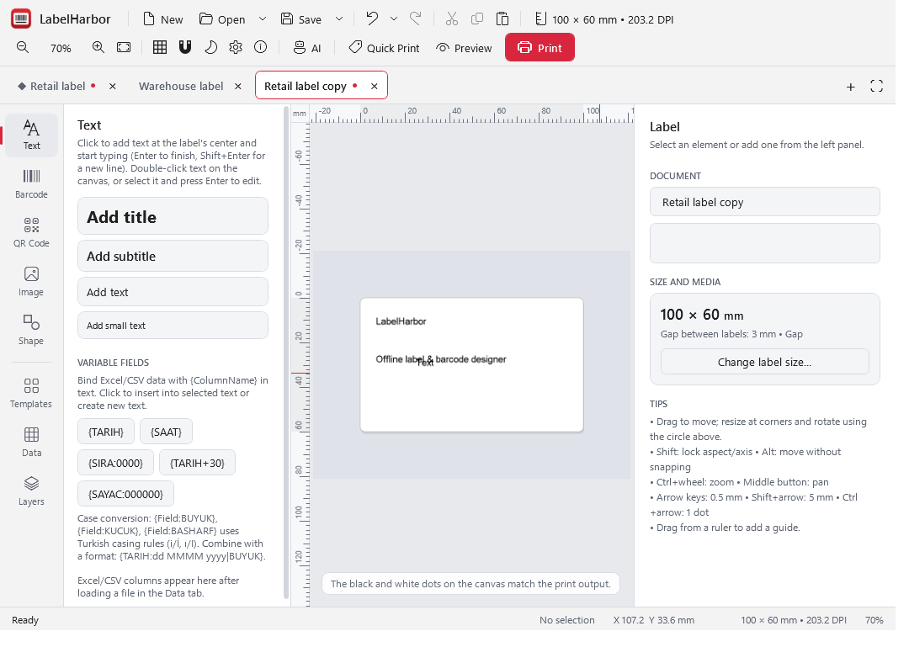

# LabelHarbor

[English](README.md) · [Türkçe](README.tr.md)

Windows için çevrimdışı etiket ve barkod tasarım uygulaması. Kaynak kod [MIT lisanslıdır](LICENSE).
Firma adı, adres, web sitesi, logo ve şablon klasörü ayarlanabilir. Hesap veya abonelik gerekmez.

<picture>
  <source media="(prefers-color-scheme: dark)" srcset="docs/images/workspace-dark.png">
  
</picture>

## İndir ve kur

[Windows x64 kurulum dosyasını indir](https://github.com/husodrn46/etiket-tasarim/releases/download/v2.1.0/LabelHarbor-Setup-2.1.0.exe)
· [Taşınabilir ZIP](https://github.com/husodrn46/etiket-tasarim/releases/download/v2.1.0/LabelHarbor-2.1.0-win-x64.zip)
· [Ön sürüm ve doğrulama bilgileri](https://github.com/husodrn46/etiket-tasarim/releases/tag/v2.1.0)

Windows 10/11 64-bit içindir; .NET çalışma zamanı pakete dahildir. Kurulum dosyasını çalıştırın veya ZIP'i
bir klasöre çıkarıp `Etiket Tasarim.exe` dosyasını açın. Ardından aşağıdaki başlangıç adımlarını izleyin.

2.1.0; bağımsız belge sekmeleri, tümünü kaydetme, sabitleme/kopyalama, odak modu ve isteğe bağlı
arayüz animasyonları ekler. İngilizce/Türkçe arayüz, kişiselleştirme, favoriler, bölgesel etiket biçimleri,
hazır paketler ve aktarım profilleri dahildir. [Doğrulama kapsamı](docs/RELEASE-READINESS.md), otomatik
kontrolleri ve elle yapılacak yazıcı/DPI denemelerini açıklar.

## Birden fazla etiketle çalışma

Dosyaları ayrı sekmelerde açın; veri ve geri alma geçmişi birbirinden ayrı kalır. Ctrl+Alt+S tümünü kaydeder;
Ctrl+Tab sekme değiştirir, Ctrl+W kapatır, Ctrl+Shift+D etiketi kopyalar, Ctrl+Shift+F odak modunu açar.
[Sekme ve animasyon rehberi](docs/DOCUMENTS-AND-MOTION.md).

## Başlangıç

1. Windows uygulamasını açın. **Ayarlar → Firma Bilgileri** bölümüne kendi bilgilerinizi girin ve logonuzu seçin.
2. **Firma bilgileriyle yeni örnek şablonlar oluştur** seçeneğini işaretleyip kaydedin. Mevcut şablonlar korunur;
   aynı ad varsa numaralı yeni kopya eklenir. Firma bilgileri bu kopyalara kaydedilir; eski tasarımlar kendiliğinden değişmez.
3. **Şablonlar** panelinden etiketi seçin. Ürün adı, fiyat, barkod ve tasarımı düzenleyin.
4. Toplu baskı için **Veri → Excel/CSV** ile kendi dosyanızı bağlayın; Hızlı Baskı için ürün listenizi içeri alın.
5. Yazıcıyı seçip rulo ölçülerini ve kalibrasyonu doğrulayın. Hazır XP-470B profili yalnız başlangıç değerleridir.

Örnek dosyalar sentetiktir. Örnek barkodların kontrol basamaklarının geçerli olması GS1 tarafından tahsis
edildikleri anlamına gelmez; bunları gerçek ürün numarası olarak kullanmayın. Örnek ürün dosyasının ikinci
satırında hata raporlamasını göstermek için bilerek hatalı kontrol basamağı vardır.

## Özellikler

- mm cinsinden sürükle-bırak tasarım; metin, barkod, QR, görsel, şekil, simgeler, gruplama ve geri alma.
- 13 barkod türü; ortak 1-bit render motoru, barkod okunabilirlik kontrolü, PNG/PDF çıktı.
- Excel/XLS/CSV, değişken alanlar, kalıcı sayaç, ürün listesi, baskı geçmişi ve yeniden baskı.
- TSPL RAW ve Windows sürücüsüyle baskı, kalibrasyon ve yazıcı/rulo profilleri.
- İsteğe bağlı, varsayılan kapalı AI/MCP altyapısı. Yeni servis, hesap veya API anahtarı kurulmaz.
  Tasarım araçları fiziksel baskı başlatamaz; bulut sağlayıcısına veri göndermek ayrıca kullanıcı izni gerektirir.

## GS1 ve veri güvenliği

Yeni kurulumda firma adı, GLN, GCP ve GTIN listesi boştur. GLN bir şirket/lokasyon kimliğidir; ürün GTIN'i
veya firma öneki olarak kullanılmaz. Uygulama GLN'den ya da şirket adından kod türetmez. SSCC için
kullanıcının kendi GS1 belgesindeki GCP'yi girip doğrulaması gerekir. Normal etiket tasarımı için GS1 üyeliği gerekmez.

Veriler `Belgeler\Etiket Tasarım`, `%APPDATA%\Etiket Tasarım` ve `%LOCALAPPDATA%\Etiket Tasarım` altında saklanır.
Deneme/taşınabilir çalışma için `ETIKET_VERI` tüm klasörleri ayrı bir köke yönlendirir. Diğer kurulumlardan
ayar, logo, ürün, şablon, GS1 veya SSCC kayıtları otomatik alınmaz. `.akelabel` dosya biçimi uyumluluk için korunur.

## Günlük kullanım iyileştirmeleri

Bu bölümdeki yenilikler `v2.1.0` indirme paketine dahildir.

- İlk açılışta firma, logo, yazıcı ve etiket ölçüsü için üç adımlı kurulum; **? → İlk kurulum** ile yeniden açılır.
- Şablon galerisinde arama, kategori ve firma şablonlarında görsel önizleme; kargo ve demirbaş tasarımları.
- **Veri tablosu → Sütunları eşleştir**: Excel/CSV sütunlarını tasarım alanlarına bağlama. Kaynak dosya değişmez;
  eşleştirme tasarımla kaydedilir ve Ctrl+Z ile geri alınır.
- Hızlı baskıda bulunamayan/belirsiz okutma önceki ürünü seçili bırakmaz; son şablon hatırlanır.
- **? → Firma, şablon ve ürün yedeği oluştur / geri yükle**: tek `.etiketyedek` dosyasıyla taşıma.
  Geri yüklenen şablonlar yeni klasöre alınır, eski ürün listesi ayrıca saklanır. Harici Excel/CSV ve görseller,
  GS1/SSCC tahsisleri, sayaçlar, baskı geçmişi ve bağlantı anahtarları pakete dahil değildir.

[Değişiklik ve doğrulama kapsamı](docs/KULLANIM-GELISTIRMELERI.md)

## Geliştirme

C# / .NET 10, WPF, CommunityToolkit.Mvvm, SkiaSharp, ZXing.Net, ClosedXML, ExcelDataReader ve CsvHelper.
Masaüstü uygulaması Windows içindir; ortak kütüphanelerin çoğu arayüz olmadan test edilebilir.

```powershell
dotnet restore AkelEtiket.sln
dotnet build AkelEtiket.sln
dotnet test AkelEtiket.sln
powershell -ExecutionPolicy Bypass -File build.ps1
```

Derleme/paket komutları yerel çıktı üretir; GitHub'a gönderim veya dağıtım yapmaz. Bu genel sürüm için Windows
kurulum/kaldırma, WPF ekranları ve gerçek yazıcı kabulü ayrıca tamamlanmalıdır.

[Geçiş ve yayın kapsamı](docs/GENEL-URUN.md) · [Mimari](docs/MIMARI.md) · [Bağımlılık lisansları](docs/LISANSLAR.md)

## Yerel Windows kurulum adayı

Genel sürümün NSIS tabanlı, kullanıcı hesabına kurulan adayı Mac/Linux/Windows üzerinde üretilebilir:

```text
python tools/distribution/build_candidate.py --dotnet <dotnet-yolu> --makensis <makensis-yolu> --cache <NuGet-paket-klasörü> --output <yeni-boş-çıktı-klasörü>
```

Çıktı: .NET/WPF/ASP.NET içeren Windows x64 uygulaması, kurulum EXE'si, taşınabilir ZIP, lisans metinleri ve
SHA-256 dosya manifesti. Bu komut yayın yapmaz. Çıktı klasörü varsa üzerine yazmaz. Bu aday için SDK 10.0.402
ve .NET 10.0.13 kullanılır; `PublishReadyToRun` platformlar arası derlemede kapalıdır.

Gerçek Windows kabulü, temiz kullanıcı profilinin **etkileşimli masaüstünde** şu betikle çalıştırılır:

```powershell
powershell -ExecutionPolicy Bypass -File tools/distribution/windows_acceptance.ps1 -Installer <kurulum-adayı.exe>
```

Betik ayrık geçici klasöre kurar, uygulamayı açar, firma adı/adresi/siteyi gerçek WPF ayar ekranından girer,
şablon üretip yeniden açar, kaldırmayı ve kullanıcı dosyalarının korunmasını kontrol eder. Sonucu
`%TEMP%\Etiket-Kabul-<kimlik>\windows-kabul.json` içine yazar. Gerçek yazıcıya baskı göndermez.
Bu betiğin burada hazırlanmış olması Windows'ta çalıştırıldığı anlamına gelmez.

## İngilizce dil desteği

Bu kaynak dalında İngilizce/Türkçe arayüz seçimi, İngilizce örnek şablonlar ve CSV dosyaları bulunur.
Ayarlar veya ilk kurulumdaki Dil / Language seçeneğinden dili seçip uygulamayı yeniden açın. Yeni kurulumlar
sistem dili Türkçeyse Türkçe, diğer dillerde İngilizce açılır; tamamlanmış eski kurulumlar Türkçe kalır.
Dil seçimi ürün/firma bilgilerini, barkodları, kayıtlı tasarımları ve veri klasörlerini değiştirmez.
Ölçüler bölgesel ondalık ayarına göre gösterilir. Düşük seviyeli bazı tanı ve isteğe bağlı AI mesajları Türkçe kalabilir.

[İngilizce kullanım rehberi](docs/USER-GUIDE.md) · [Dil altyapısı ve uyumluluk](docs/INTERNATIONALIZATION.md).
Bu değişiklikler `v2.1.0` indirme paketine dahildir.

## Kişiselleştirme ve hazır iş akışları

Vurgu rengi, arayüz ölçeği, yeni metin yazı tipi, başlangıç şablonu ve panel düzeni seçilebilir. Şablon/baskı
favorileri, etiket bazında tarih/sayı/para biçimleri, aktarım önerileri ve tekrar kullanılabilen profiller eklendi.
Dört paket sekiz tasarım, kurgusal CSV ve iki dilli tarif sunar. Bu özellikler `v2.1.0` paketine dahildir.
[Türkçe kullanım](docs/WORKFLOWS.tr.md) · [English guide](docs/WORKFLOWS.md).
